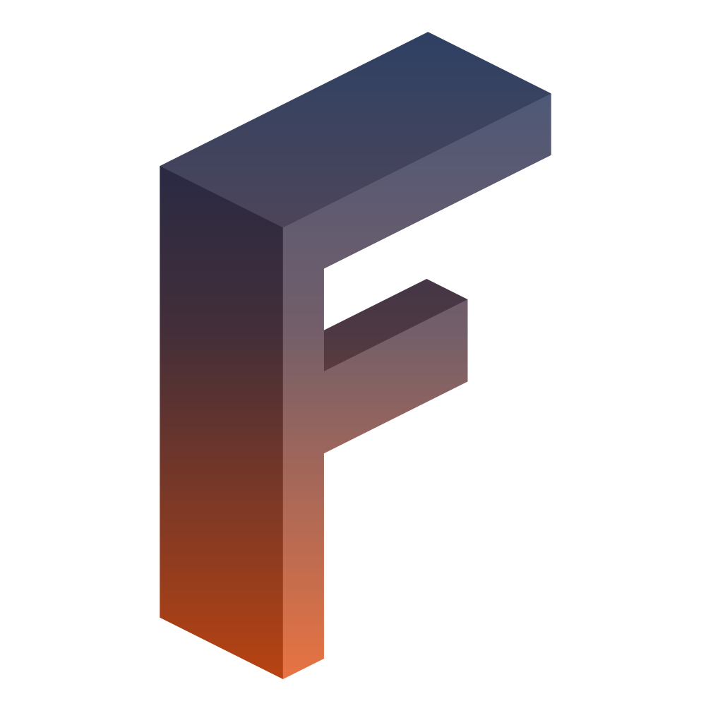

<p align="center">
    
</p>

<div align="center">

[](https://packagist.org/packages/forumify/forumify-calendar-plugin)
[](https://packagist.org/packages/forumify/forumify-calendar-plugin)
[](https://packagist.org/packages/forumify/forumify-calendar-plugin)
[](https://packagist.org/packages/forumify/forumify-calendar-plugin)


[](https://github.com/forumify/forumify-calendar-plugin/actions/workflows/tests.yml)
[](https://github.com/forumify/forumify-calendar-plugin/actions/workflows/quality.yml)

</div>

# forumify Calendar

**Keep your community informed about your events**

The calendar plugin brings event scheduling to your [forumify](https://github.com/forumify/forumify-platform) community. Create as many calendars as you need, fill them with one-off or recurring events, and let your members subscribe so they never miss a thing.

📖 **Documentation:** [docs.forumify.net/plugins/calendar-plugin](https://docs.forumify.net/plugins/calendar-plugin)

## Features

- **Multiple calendars**: each with its own name, color and permissions, so you decide who can see and who can manage events on every calendar.
- **Month, week and list views**: browse a single calendar or all of them at once. Members' preferred view is remembered between visits.
- **Recurring events**: repeat events daily, weekly, monthly or annually, with an optional end date. Recurring events keep the same wall-clock time across daylight saving time changes.
- **Rich events**: give events a description and a banner image, and manage them straight from the frontend.
- **Timezone aware**: times are shown in each member's own timezone.
- **Notifications**: members can subscribe to new events on any calendar, by email and in-app.
- **Event reminders**: members can be reminded 15 minutes, 1 hour or 1 day before each event starts.

### Integrations

Other forumify plugins can put their own events on your calendars. For example, [forumify-milhq-plugin](https://github.com/forumify/forumify-milhq-plugin) shows missions and course classes on the calendar.

## Installation

The calendar plugin can be installed from the [forumify marketplace](https://forumify.net/marketplace), or manually with composer:

```bash
composer require forumify/forumify-calendar-plugin
```

Afterwards, activate the plugin from the plugins page in your forumify admin panel, and create your first calendar under Settings -> Calendar.

Notifications and reminders are sent by forumify's background workers, so make sure the message consumer and the scheduler are running on your site.

See the [documentation](https://docs.forumify.net/plugins/calendar-plugin) to add the calendar to your menu and start scheduling events.

## Contributing

When you believe you've found a bug or think the plugin could be expanded with a new feature, you can start by creating an issue [here on GitHub](https://github.com/forumify/forumify-calendar-plugin/issues).

The easiest way to work on the calendar plugin is by using the [production template](https://github.com/forumify/forumify-production-template) and installing the plugin with composer using a symlink.

Add the following to the template's `composer.json`:
```json
    "repositories": [
        {
            "type": "path",
            "url": "../forumify-calendar-plugin"
        }
    ]
```

Now when you run `composer require forumify/forumify-calendar-plugin`, the plugin will be symlinked and any changes you make will immediately be available in your project.

### Code quality

The following checks are performed when you create a pull request:
- Tests: [PHPUnit](https://phpunit.de/)
- CodeStyle: checked by [PHPCS](https://github.com/PHPCSStandards/PHP_CodeSniffer/), using the [PSR-2 codestyle](https://www.php-fig.org/psr/psr-2/) extended with [Slevomat](https://github.com/slevomat/coding-standard) rules
- Static analysis: checked by [PHPStan](https://phpstan.org/)
- JavaScript: checked by [ESLint](https://eslint.org/)

You can avoid failing builds by running these tools locally:

On Linux/WSL/MacOS:

- Quality checks: `make quality`
- Tests: `make tests`

The tests require a MySQL 8.4 database, configured through `DATABASE_URL` in `.env`.

On Windows:

- See commands in `Makefile` and execute manually.

## License

The calendar plugin is released under the [Open Software License 3.0](https://opensource.org/license/osl-3-0-php).
